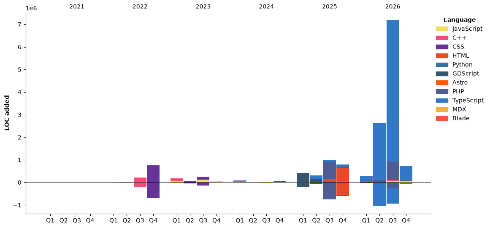

<h1>
Is anyone there?
Oh hi!
</h1>
<p>⚡ Fun fact: I like tamales 🫔</p>

<div align="center">
  
</div>

## 💻 Tech Stack:
<div align="center">
  
  
  
  
  
  
  
  
  
  
  
  
  
  
  
  
   
  
</div>

## Stats section
<!--START_SECTION:waka-->


**🐱 My GitHub Data** 

> 📦 561.4 kB Used in GitHub's Storage 
 > 
> 🏆 2,689 Contributions in the Year 2026
 > 
> 🚫 Not Opted to Hire
 > 
> 📜 21 Public Repositories 
 > 
> 🔑 31 Private Repositories 
 > 
**I'm an Early 🐤** 

```text
🌞 Morning                4272 commits        ████░░░░░░░░░░░░░░░░░░░░░   17.39 % 
🌆 Daytime                12172 commits       ████████████░░░░░░░░░░░░░   49.54 % 
🌃 Evening                6180 commits        ██████░░░░░░░░░░░░░░░░░░░   25.15 % 
🌙 Night                  1946 commits        ██░░░░░░░░░░░░░░░░░░░░░░░   07.92 % 
```
📅 **I'm Most Productive on Tuesday** 

```text
Monday                   3543 commits        ████░░░░░░░░░░░░░░░░░░░░░   14.42 % 
Tuesday                  5626 commits        ██████░░░░░░░░░░░░░░░░░░░   22.90 % 
Wednesday                3356 commits        ███░░░░░░░░░░░░░░░░░░░░░░   13.66 % 
Thursday                 4174 commits        ████░░░░░░░░░░░░░░░░░░░░░   16.99 % 
Friday                   5326 commits        █████░░░░░░░░░░░░░░░░░░░░   21.68 % 
Saturday                 1020 commits        █░░░░░░░░░░░░░░░░░░░░░░░░   04.15 % 
Sunday                   1525 commits        ██░░░░░░░░░░░░░░░░░░░░░░░   06.21 % 
```


📊 **This Week I Spent My Time On** 

```text
🕑︎ Time Zone: America/Mexico_City

💬 Programming Languages: 
Other                    2 hrs 56 mins       ███████░░░░░░░░░░░░░░░░░░   28.75 % 
PHP                      1 hr 48 mins        ████░░░░░░░░░░░░░░░░░░░░░   17.73 % 
Markdown                 1 hr 40 mins        ████░░░░░░░░░░░░░░░░░░░░░   16.36 % 
JavaScript               1 hr 6 mins         ███░░░░░░░░░░░░░░░░░░░░░░   10.89 % 
TypeScript               1 hr 5 mins         ███░░░░░░░░░░░░░░░░░░░░░░   10.61 % 

🔥 Editors: 
Claude Code              9 hrs 24 mins       ███████████████████████░░   92.14 % 
VS Code                  48 mins             ██░░░░░░░░░░░░░░░░░░░░░░░   07.86 % 

🐱‍💻 Projects: 
gyemant                  2 hrs 21 mins       ██████░░░░░░░░░░░░░░░░░░░   23.11 % 
urbani-admin             2 hrs 12 mins       █████░░░░░░░░░░░░░░░░░░░░   21.56 % 
urbani-support-functions 1 hr 17 mins        ███░░░░░░░░░░░░░░░░░░░░░░   12.72 % 
backend                  48 mins             ██░░░░░░░░░░░░░░░░░░░░░░░   07.98 % 
gviall-test              45 mins             ██░░░░░░░░░░░░░░░░░░░░░░░   07.39 % 

💻 Operating System: 
Linux                    10 hrs 12 mins      █████████████████████████   100.00 % 
```

🤖 **AI Coding This Week** 

```text
⏱ AI Coding Time: 9 hrs 42 mins (95.04%)

✍️ 7,775 lines written by AI, 2 lines written by hand (99.97% AI-written)

🔤 9,262,188 Input Tokens, 2,178,424 Output Tokens

💵 $381.48 Estimated AI Cost This Week

🧠 19 AI Sessions, 109 AI Prompts

Opus                     9,441 lines         ████████████████████████░   97.19 % 
Fable                    273 lines           █░░░░░░░░░░░░░░░░░░░░░░░░   02.81 % 

🔎 AI Coding Insights:
🤖 AI-Driven — 99.97% of written lines came from AI
📚 Verbose Prompter — average 5,875 characters per prompt
🔁 Iterative Prompter — average 6 prompts per session
🚀 High AI Trust — 0.02% of changed lines were hand-edited
```

**Timeline**




 Last Updated on 31/10/2026 21:59:35 UTC
<!--END_SECTION:waka-->


